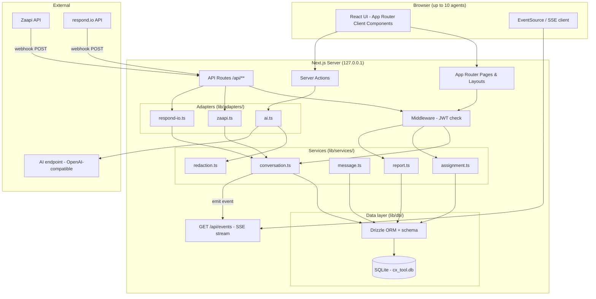
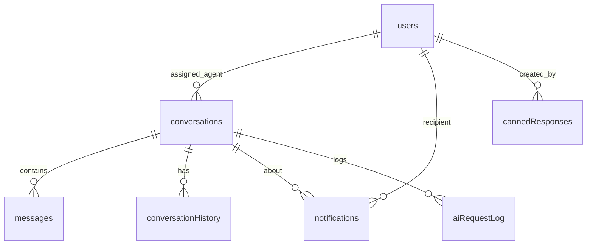
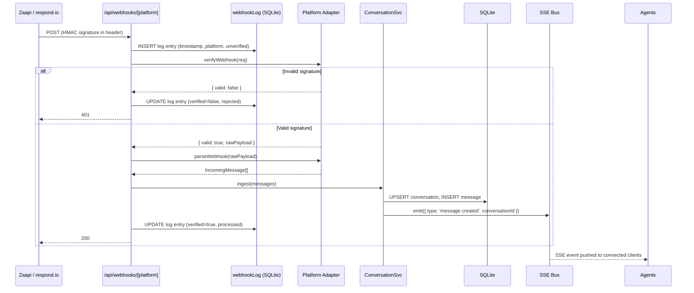

# Design Document: CX Support Tool

## Overview

The CX Support Tool is a local-first, multi-agent web application built on the existing Next.js 16 (App Router) stack. It gives the Photobook support team a single unified inbox for conversations arriving from Zaapi and respond.io across WhatsApp, Facebook, Instagram, LINE, Shopee, Lazada, TikTok, and the website widget. Agents read and reply to conversations from one browser tab; supervisors manage routing and view reports.

The app runs on the owner's Mac at `127.0.0.1`. Up to ten agents connect over the local network through the Mac's hostname or IP. There is no hosted deployment in the MVP.

**Key design decisions:**

| Decision | Choice | Rationale |
|---|---|---|
| Database | SQLite (better-sqlite3) | Single file, no separate server, adequate for ≤10 concurrent writers on local network |
| Real-time | Server-Sent Events (SSE) | One-directional push (server → client) covers inbox updates; simpler than WebSocket for local LAN; native browser support with `EventSource` |
| Auth | Stateless JWT cookie (Jose) | No external auth service; 8-hour expiry enforced server-side; HttpOnly cookie prevents JS access |
| ORM / query | Drizzle ORM | Type-safe SQL, thin abstraction, good SQLite support, generates migrations |
| Adapter isolation | Each platform and AI in its own module under `lib/adapters/` | Adapters can be swapped or extended without touching storage or UI code |
| Session storage | Cookie-based (encrypted JWT) | Avoids a sessions table; simpler for single-server local deployment |

---

## Architecture

### High-level component diagram



### Request lifecycle summary

1. **Webhook ingestion**: Platform POSTs to `/api/webhooks/zaapi` or `/api/webhooks/respond-io`. The middleware verifies the HMAC signature; on failure, returns 401 without storing the payload. On success, the matching adapter normalises the payload to the internal `IncomingMessage` shape, writes to SQLite, and emits an SSE event to all connected clients.
2. **Agent reply**: Agent submits a reply via a Server Action. The action reads the conversation's `platform` field, routes to the matching adapter, calls the outbound API, and writes the sent message to SQLite with `status: 'pending'`. The platform adapter updates status to `sent` on API confirmation or `failed` on error.
3. **AI suggestion**: Agent clicks "Suggest reply". A Server Action calls `RedactionSvc.redact(thread)`, then `AIAdapter.suggest(redactedThread)`. The suggestion is returned as editable text; nothing is auto-sent.
4. **SSE push**: Any write that affects inbox state calls `emitEvent(conversationId, eventType)`. Each connected agent's SSE stream checks role/assignment filters before forwarding the event.

---

## Components and Interfaces

### Adapter interface

All platform adapters implement the same contract, defined in `lib/adapters/types.ts`:

```ts
// lib/adapters/types.ts
export interface IncomingMessage {
  externalId: string        // platform-assigned message ID
  externalConversationId: string
  platform: 'zaapi' | 'respond_io'
  channel: Channel
  direction: 'inbound' | 'outbound'
  senderName: string | null
  body: string | null
  hasAttachment: boolean
  sentAt: Date
}

export interface OutboundReply {
  conversationId: string    // internal ID
  externalConversationId: string // adapters cannot read the DB
  body: string
}

// Zaapi returns no message id; its outbound copy arrives later via the message.sent webhook.
export type SendResult =
  | { status: 'sent'; externalMessageId: string | null }
  | { status: 'failed'; errorMessage: string }

export interface WebhookVerificationResult {
  valid: boolean
  rawPayload: string        // stored for logging regardless of validity
}

export interface PlatformAdapter {
  verifyWebhook(req: Request): Promise<WebhookVerificationResult>
  parseWebhook(rawPayload: string): Promise<IncomingMessage[]>
  sendReply(reply: OutboundReply): Promise<SendResult>
}
```

The AI adapter has its own contract in `lib/adapters/ai.ts`:

```ts
// lib/adapters/ai.ts
export interface AISuggestionRequest {
  redactedThread: Array<{ role: 'customer' | 'agent'; content: string }>
  modelName: string
  endpointUrl: string
  apiKey: string
}

export interface AISuggestionResult {
  suggestion: string | null
  errorMessage?: string
}

export interface AIAdapter {
  suggest(req: AISuggestionRequest): Promise<AISuggestionResult>
}
```

### SSE event bus

A lightweight in-process event bus (`lib/events/bus.ts`) holds a `Map<clientId, ReadableStreamController>`. When a service calls `bus.emit(event)`, the bus iterates connected controllers and writes the JSON event to each. The SSE route at `/api/events` subscribes a controller on `GET` and removes it on stream close.

```ts
// lib/events/types.ts
export type SSEEventType =
  | 'conversation.created'
  | 'conversation.updated'
  | 'message.created'
  | 'conversation.assigned'
  | 'conversation.status_changed'
  | 'notification.created'

export interface SSEEvent {
  type: SSEEventType
  conversationId: string
  payload: Record<string, unknown>
}
```

### Redaction module

`lib/services/redaction.ts` exposes a single `redact(text: string): string` function. It applies patterns in order:

| PII type | Pattern | Replacement |
|---|---|---|
| Email | RFC 5322 email regex | `[EMAIL]` |
| Malaysian/SG phone | `+60`, `+65`, `01x-xxxxxxx` formats | `[PHONE]` |
| Order number | Alphanumeric pattern matching Photobook order format | `[ORDER]` |
| Street address / postcode | Address heuristic patterns | `[ADDRESS]` |
| Customer name | Names from the conversation's `customer_name` field, escaped | `[NAME]` |

The module is pure (no I/O) and unit-tested with fixtures covering each pattern and mixed inputs.

### Auth middleware

`middleware.ts` at the project root runs on every request matching `/((?!_next|api/webhooks).*)`. It reads the `session` cookie, decrypts the JWT with `jose`, and attaches `{ userId, role }` to the request via a Next.js request header (`x-auth-user`). Webhook routes are explicitly excluded because they use HMAC verification instead.

Server Actions and API route handlers read the user from `getSession()` in `lib/auth/session.ts`, which reads the header set by middleware. Any request without a valid session redirects to `/login` (page routes) or returns HTTP 401 (API routes).

---

## Data Models

### SQLite schema (Drizzle)

```ts
// lib/db/schema.ts (Drizzle table definitions — abbreviated to key columns)

// Users and sessions
users: {
  id: text (PK, UUID),
  username: text (unique),
  passwordHash: text,       // bcrypt hash
  displayName: text,
  role: text,               // 'agent' | 'supervisor'
  createdAt: integer (epoch ms),
  isActive: integer (0|1)
}

// Connected platform configurations (stored in env; this table holds non-secret metadata)
platformConfigs: {
  id: text (PK),
  platform: text,           // 'zaapi' | 'respond_io'
  webhookSecret: text,      // for HMAC verification — loaded from env, never committed
  isActive: integer (0|1)
}

// Conversations
conversations: {
  id: text (PK, UUID),
  externalId: text,         // platform-assigned conversation ID
  platform: text,           // 'zaapi' | 'respond_io'
  channel: text,            // 'whatsapp' | 'facebook' | 'instagram' | 'line' | 'shopee' | 'lazada' | 'tiktok' | 'widget'
  status: text,             // 'open' | 'snoozed' | 'resolved'
  snoozedUntil: integer,    // epoch ms, null unless snoozed
  assignedAgentId: text,    // FK → users.id, nullable
  customerName: text,       // display name from platform
  customerIdentifier: text, // phone/email/username
  unreadCount: integer,
  lastMessageAt: integer,   // epoch ms
  lastMessagePreview: text,
  createdAt: integer,
  updatedAt: integer,
  UNIQUE(externalId, platform)
}

// Messages
messages: {
  id: text (PK, UUID),
  conversationId: text,     // FK → conversations.id
  externalId: text,         // platform message ID
  direction: text,          // 'inbound' | 'outbound'
  senderName: text,
  body: text,
  hasAttachment: integer (0|1),
  status: text,             // 'pending' | 'sent' | 'failed' | 'delivered'
  sentAt: integer,          // epoch ms
  createdAt: integer,
  UNIQUE(externalId, conversationId)
}

// Conversation status history
conversationHistory: {
  id: text (PK, UUID),
  conversationId: text,     // FK → conversations.id
  fromStatus: text,
  toStatus: text,
  changedBy: text,          // FK → users.id, nullable (null = system)
  reason: text,             // nullable
  changedAt: integer
}

// In-app notifications
notifications: {
  id: text (PK, UUID),
  userId: text,             // FK → users.id
  conversationId: text,     // FK → conversations.id
  type: text,               // 'assigned' | 'message'
  isRead: integer (0|1),
  createdAt: integer
}

// Canned responses
cannedResponses: {
  id: text (PK, UUID),
  name: text,
  shortcode: text (unique),
  body: text,               // may contain {{customer_name}}
  createdBy: text,          // FK → users.id
  createdAt: integer,
  updatedAt: integer
}

// Auto-assignment rules
assignmentRules: {
  id: text (PK, UUID),
  strategy: text,           // 'round_robin' | 'manual'
  manualAgentId: text,      // FK → users.id, null for round_robin
  isActive: integer (0|1),
  updatedBy: text,
  updatedAt: integer
}

// Round-robin state (tracks last assigned agent to implement rotation)
roundRobinState: {
  id: integer (PK, autoincrement),
  lastAssignedAgentId: text,
  updatedAt: integer
}

// Webhook event log (append-only)
webhookLog: {
  id: text (PK, UUID),
  platform: text,
  receivedAt: integer,
  verified: integer (0|1),
  processingStatus: text,   // 'processed' | 'failed' | 'rejected'
  errorMessage: text
  // NOTE: raw payload is NOT stored — only metadata
}

// AI request log (no PII)
aiRequestLog: {
  id: text (PK, UUID),
  conversationId: text,
  modelName: text,
  requestedAt: integer,
  responseMs: integer,
  success: integer (0|1),
  errorMessage: text
  // NOTE: prompt and response text are NOT stored
}
```

### Entity relationships



---

## API Route Structure

All routes use the Next.js 16 App Router. Routes under `/api/` return JSON; page routes return HTML via Server Components.

```
app/
├── (auth)/
│   └── login/
│       └── page.tsx                     # Login page (public)
├── (app)/                               # Protected layout (middleware enforces auth)
│   ├── layout.tsx                       # Shared shell: sidebar, nav, SSE connection
│   ├── inbox/
│   │   └── page.tsx                     # Unified inbox
│   ├── inbox/[conversationId]/
│   │   └── page.tsx                     # Conversation thread + compose
│   ├── reports/
│   │   └── page.tsx                     # Supervisor reports (supervisor only)
│   └── settings/
│       └── page.tsx                     # AI + canned response settings (supervisor only)
│
api/
├── auth/
│   ├── login/route.ts                   # POST — authenticate, set session cookie
│   └── logout/route.ts                  # POST — delete session cookie
├── events/route.ts                      # GET — SSE stream (auth required)
├── conversations/
│   ├── route.ts                         # GET — list with filters; query params: platform, channel, status, assignedTo, search, page
│   └── [id]/
│       ├── route.ts                     # GET — single conversation with messages
│       ├── assign/route.ts              # POST — assign conversation (supervisor or self-assign)
│       ├── status/route.ts              # PATCH — change status (open/snoozed/resolved)
│       ├── messages/route.ts            # POST — send reply
│       └── ai-suggest/route.ts          # POST — request AI suggestion (supervisor only endpoint, or agent via allowlist)
├── canned-responses/
│   ├── route.ts                         # GET — list; POST — create (supervisor)
│   └── [id]/route.ts                    # PUT — update; DELETE — delete (supervisor)
├── notifications/
│   └── route.ts                         # GET — agent's notifications; PATCH — mark read
├── reports/
│   └── route.ts                         # GET — aggregated metrics; query params: from, to, agentId, channel, platform
├── settings/
│   └── ai/route.ts                      # GET/PUT — AI endpoint config (supervisor only)
└── webhooks/
    ├── zaapi/route.ts                   # POST — Zaapi webhook ingestion (no auth, HMAC verified)
    └── respond-io/route.ts              # POST — respond.io webhook ingestion (no auth, HMAC verified)
```

### Key route behaviours

**GET /api/conversations** — agents see only conversations assigned to them or unassigned; supervisors see all. The query runs against SQLite with index-backed filters on `(status, assignedAgentId, platform, channel)`. Pagination uses a cursor on `lastMessageAt DESC`.

**GET /api/events** — returns a `text/event-stream` response. The handler registers a controller with the SSE bus, then keeps the connection alive with 30-second keepalive comments (`:\n\n`). On close, the controller is removed. Each event is filtered server-side: agents receive events only for conversations they can access.

**POST /api/webhooks/zaapi** — logs the event immediately (timestamp + platform, no payload content), then verifies the signature. Invalid signatures return 401 and log the rejection. Valid payloads are parsed by `ZaapiAdapter.parseWebhook()` and handed to `ConversationSvc.ingest()`.

**POST /api/conversations/[id]/messages** — calls the platform adapter's `sendReply()`. Writes the message with `status: 'pending'` synchronously, returns HTTP 202 to the client, and updates `status` to `sent`/`failed` after the platform API responds. Emits an SSE event in both cases.

---

## Real-time Update Mechanism

### Why Server-Sent Events

For a local LAN deployment with one-directional push (server notifying clients of new data), SSE fits better than WebSocket because:

- No protocol upgrade or connection library needed; native `EventSource` in all modern browsers.
- Next.js 16 App Router supports long-lived `ReadableStream` responses natively.
- One-way push is all that is needed: client writes (replies, assignments) go through API routes as normal HTTP.

### Implementation

The SSE bus is an in-process `Map` (fine for single-process local deployment — no clustering):

```ts
// lib/events/bus.ts
type Controller = ReadableStreamDefaultController<Uint8Array>

const clients = new Map<string, { controller: Controller; userId: string; role: string }>()

export function addClient(id: string, controller: Controller, userId: string, role: string) {
  clients.set(id, { controller, userId, role })
}

export function removeClient(id: string) {
  clients.delete(id)
}

export function emit(event: SSEEvent, visibleToUserId?: string) {
  const data = `data: ${JSON.stringify(event)}\n\n`
  const bytes = new TextEncoder().encode(data)
  for (const [, client] of clients) {
    // Supervisors receive all events; agents receive events for accessible conversations only
    if (visibleToUserId === undefined || client.role === 'supervisor' || client.userId === visibleToUserId) {
      try { client.controller.enqueue(bytes) } catch { /* client disconnected */ }
    }
  }
}
```

The SSE route:

```ts
// app/api/events/route.ts
export async function GET(req: Request) {
  const session = await getSession(req)
  if (!session) return new Response(null, { status: 401 })

  const clientId = crypto.randomUUID()
  const stream = new ReadableStream({
    start(controller) {
      addClient(clientId, controller, session.userId, session.role)
      // Keepalive ping every 30s
      const ping = setInterval(() => {
        try { controller.enqueue(new TextEncoder().encode(': keepalive\n\n')) }
        catch { clearInterval(ping) }
      }, 30_000)
    },
    cancel() {
      removeClient(clientId)
    }
  })

  return new Response(stream, {
    headers: {
      'Content-Type': 'text/event-stream',
      'Cache-Control': 'no-cache',
      'Connection': 'keep-alive',
    }
  })
}
```

Clients reconnect automatically via `EventSource`'s built-in retry behaviour. On reconnect, the client fetches the current inbox state via `GET /api/conversations` to fill any gap.

---

## Module / Adapter Isolation Strategy

```
lib/
├── adapters/
│   ├── types.ts            # PlatformAdapter interface + shared types
│   ├── zaapi.ts            # Implements PlatformAdapter for Zaapi
│   ├── respond-io.ts       # Implements PlatformAdapter for respond.io
│   └── ai.ts               # Implements AIAdapter
├── auth/
│   ├── session.ts          # encrypt/decrypt JWT, createSession, getSession, deleteSession
│   └── passwords.ts        # bcrypt hash/verify wrappers
├── db/
│   ├── index.ts            # Drizzle client singleton (better-sqlite3)
│   ├── schema.ts           # All table definitions
│   └── migrations/         # Drizzle-generated SQL migration files
├── events/
│   ├── bus.ts              # SSE event bus
│   └── types.ts            # SSEEvent type definitions
└── services/
    ├── conversation.ts     # Ingest, query, status transitions
    ├── assignment.ts       # Assign, reassign, auto-assign, round-robin state
    ├── message.ts          # Store sent/received messages
    ├── redaction.ts        # PII redaction (pure function)
    ├── canned-response.ts  # CRUD + shortcode search
    └── report.ts           # Aggregation queries for supervisor reports
```

**Isolation rules:**
- Adapters import only from `lib/adapters/types.ts` and standard libraries; they never import from services or the DB directly.
- Services import from `lib/db/` and `lib/events/`; they never import from adapters.
- API route handlers import from services and adapters; they never import directly from `lib/db/schema.ts` except through the service layer.
- The redaction module imports nothing from the project; it is a pure function library.
- The AI adapter imports `redaction.ts` to enforce that redaction happens before any outbound AI call.

---

## Auth Approach

### Session lifecycle

1. **Login**: `POST /api/auth/login` — validates username + password (bcrypt compare), creates a signed JWT containing `{ userId, role, exp: now + 8h }` using `jose` with a `SESSION_SECRET` from env, and sets it as an HttpOnly, SameSite=Lax cookie.
2. **Request authentication**: middleware decrypts and validates the JWT on every non-webhook, non-static request. Expired tokens redirect to login.
3. **Session sliding**: each successful page navigation refreshes the cookie's expiry by 8 hours (implemented in middleware after a successful validation).
4. **Logout**: `POST /api/auth/logout` — deletes the cookie.

### Role enforcement

The middleware sets `x-auth-user` (JSON-encoded `{ userId, role }`) on the request. Service functions check this before returning data:

- `getConversations()` filters by `assignedAgentId = userId` for agents.
- Supervisor-only routes (`/api/reports`, `/api/settings/ai`, assignment config) return 403 if `role !== 'supervisor'`.
- API-layer enforcement (Requirement 10.4): the conversation service always applies the ownership filter regardless of how the request is made.

### Password storage

Passwords are hashed with `bcryptjs` at a cost factor of 12. Plaintext passwords are never stored, logged, or returned from any API.

---

## Key Data Flows

### 1. Webhook ingestion



### 2. Agent reply send

```mermaid
sequenceDiagram
    participant Agent as Agent Browser
    participant Action as Server Action (or API route)
    participant Svc as MessageSvc
    participant DB as SQLite
    participant Adapter as Platform Adapter
    participant Platform as Zaapi / respond.io
    participant Bus as SSE Bus

    Agent->>Action: submit reply text + conversationId
    Action->>DB: read conversation.platform, conversation.externalId
    Action->>Svc: storeOutbound(conversationId, body)
    Svc->>DB: INSERT message (status='pending')
    Svc->>Bus: emit({ type: 'message.created', status: 'pending' })
    Action->>Adapter: sendReply({ conversationId, externalConversationId, body })
    alt API success
        Adapter-->>Action: { status: 'sent', externalMessageId }
        Action->>DB: UPDATE message (status='sent', externalId if returned)
        Action->>Bus: emit({ type: 'message.created', status: 'sent' })
    else API error / timeout (30s)
        Adapter-->>Action: { status: 'failed', errorMessage }
        Action->>DB: UPDATE message (status='failed')
        Action->>Bus: emit({ type: 'message.created', status: 'failed' })
        Action-->>Agent: error displayed; message marked failed, retryable
    end
```

### 3. AI reply suggestion

```mermaid
sequenceDiagram
    participant Agent as Agent Browser
    participant Action as Server Action
    participant Svc as ConversationSvc
    participant Redact as RedactionSvc
    participant AIAdapter as AIAdapter
    participant AILog as aiRequestLog
    participant Endpoint as AI Endpoint

    Agent->>Action: request suggestion for conversationId
    Action->>Svc: getThread(conversationId)
    Svc-->>Action: messages[]
    Action->>Redact: redact(thread text)
    Redact-->>Action: redactedThread (no PII)
    Action->>AILog: INSERT log (conversationId, model, requestedAt)
    Action->>AIAdapter: suggest({ redactedThread, modelName, endpointUrl, apiKey })
    AIAdapter->>Endpoint: POST /v1/chat/completions
    alt Response within 10s
        Endpoint-->>AIAdapter: suggestion text
        AIAdapter-->>Action: { suggestion }
        Action->>AILog: UPDATE log (success=true, responseMs)
        Action-->>Agent: suggestion inserted as editable draft
    else Timeout or error
        AIAdapter-->>Action: { suggestion: null, errorMessage }
        Action->>AILog: UPDATE log (success=false, error)
        Action-->>Agent: inline error; compose area unblocked
    end
```

---

## Correctness Properties

*A property is a characteristic or behavior that should hold true across all valid executions of a system — essentially, a formal statement about what the system should do. Properties serve as the bridge between human-readable specifications and machine-verifiable correctness guarantees.*

### Property 1: Inbox items contain all required fields

*For any* conversation record stored in the database, the inbox serialization function SHALL produce an object containing: customer name or identifier, channel, platform, last message timestamp, and message preview.

**Validates: Requirements 1.4**

---

### Property 2: Inbox filter returns only matching conversations

*For any* set of conversations and any filter combination (platform, channel, assignment status, conversation status), the filtered result SHALL contain only conversations that satisfy every applied filter, and SHALL not omit any conversation that satisfies all applied filters.

**Validates: Requirements 1.5**

---

### Property 3: Inbox search returns only matching conversations

*For any* set of conversations and any non-empty search query, the search result SHALL contain only conversations where at least one of (customer name, channel identifier, last message preview) contains the query string, case-insensitively.

**Validates: Requirements 1.6**

---

### Property 4: Message thread is in chronological order

*For any* set of messages belonging to a conversation, the returned thread SHALL list messages in ascending order of their `sentAt` timestamp (earliest first).

**Validates: Requirements 1.7**

---

### Property 5: Assigned conversation reflects assigned agent

*For any* open conversation and any active agent, after executing an assignment, the conversation record SHALL have `assignedAgentId` equal to the agent's ID.

**Validates: Requirements 4.1, 4.4**

---

### Property 6: Assignment produces a notification for the assignee

*For any* assignment action where the target agent differs from the previous assignee, a notification record SHALL be created with `userId` equal to the new assignee's ID and `type = 'assigned'`.

**Validates: Requirements 4.2**

---

### Property 7: Unassigned conversations appear in queue

*For any* conversation with `assignedAgentId = null` and `status = 'open'`, the queue query SHALL include that conversation.

**Validates: Requirements 4.5**

---

### Property 8: Round-robin assignment distributes conversations evenly

*For any* set of N active agents using the round-robin strategy and any M sequential assignment calls, no agent SHALL receive more than ⌈M/N⌉ assignments.

**Validates: Requirements 4.6**

---

### Property 9: Resolved conversations are absent from the queue

*For any* conversation transitioned to `status = 'resolved'`, the queue query SHALL not return that conversation.

**Validates: Requirements 4.7, 7.1**

---

### Property 10: Canned response shortcode filter returns exact prefix matches

*For any* shortcode prefix string and any library of canned responses, the filtered result SHALL contain exactly those responses whose shortcode starts with the prefix (case-insensitive), and no others.

**Validates: Requirements 6.3**

---

### Property 11: Canned response placeholder substitution removes the token

*For any* canned response body containing `{{customer_name}}` and any customer display name, inserting the response SHALL produce text where every occurrence of `{{customer_name}}` is replaced by the customer's name and no literal `{{customer_name}}` token remains.

**Validates: Requirements 6.5**

---

### Property 12: Snoozed conversation is hidden before snooze expiry

*For any* conversation snoozed until time T, inbox queries at any time t < T SHALL not return that conversation; at any time t ≥ T the conversation SHALL be returned as `status = 'open'`.

**Validates: Requirements 7.2**

---

### Property 13: New message reopens resolved or snoozed conversation

*For any* conversation with `status` in `{'resolved', 'snoozed'}`, ingesting a new inbound message SHALL transition the conversation to `status = 'open'`.

**Validates: Requirements 7.3**

---

### Property 14: Every status transition is recorded in history

*For any* conversation that undergoes N status transitions, the `conversationHistory` table SHALL contain at least N rows with `conversationId` matching that conversation.

**Validates: Requirements 7.4**

---

### Property 15: Report totals match the underlying data

*For any* date range and any filter combination, the total conversations received reported by the reports API SHALL equal the count of conversation records with `createdAt` in the range matching the filter, and the total resolved SHALL equal the count of those records with `status = 'resolved'`.

**Validates: Requirements 8.1**

---

### Property 16: Agent role cannot access supervisor-only endpoints

*For any* valid agent-role session and any supervisor-only API route (reports, AI settings, assignment rule configuration, canned response management), the response SHALL have HTTP status 403.

**Validates: Requirements 9.3, 9.4**

---

### Property 17: Agent cannot read another agent's conversations

*For any* agent session for user A and any conversation assigned to user B (where A ≠ B and B is not null), the conversation detail endpoint SHALL return HTTP 403 or 404, never the conversation data.

**Validates: Requirements 10.4**

---

### Property 18: Invalid webhook signatures are always rejected

*For any* webhook request with an HMAC signature that does not match the computed signature for the payload and the platform's secret, the webhook endpoint SHALL return HTTP 401 and SHALL not persist the payload.

**Validates: Requirements 10.5**

---

### Property 19: PII redaction removes all recognised patterns

*For any* input string containing one or more recognised PII tokens (email, phone, order number, address, name), the `redact()` function SHALL return a string in which no original PII token is present, and each replaced position contains the appropriate labelled placeholder.

**Validates: Requirements 12.6**

---

## Error Handling

| Scenario | Behaviour |
|---|---|
| Webhook HMAC invalid | Return 401; log rejection without storing payload; emit no SSE event |
| Webhook processing error | Return 500; log error with stack; event log marked `failed`; retry policy left to platform |
| Platform API send failure | Mark message `failed`; surface error to agent; allow retry; do not discard message |
| Platform API send timeout (30 s) | Same as failure; mark `unconfirmed` with retry option |
| AI endpoint timeout (10 s) | Return error message to agent; compose area remains accessible; log without PII |
| AI endpoint error response | Same as timeout |
| Database write failure | Log error; return 500; do not emit SSE event for incomplete write |
| Database connection lost | Display error state to all agents via SSE `error` event; buffer incoming webhooks in memory for up to 60 s before returning 503 |
| Session expired | Redirect to login (page requests); return 401 (API requests) |
| Unverified attachment URLs | Never fetched or proxied; image `src` attributes use the platform-provided URL directly in the browser |

---

## Testing Strategy

### Unit tests

Focus on pure functions and business logic with no external dependencies:

- **`RedactionSvc.redact()`**: fixtures covering each PII type, mixed inputs, and strings with no PII (should be unchanged).
- **Canned response shortcode filter**: prefix matching across various inputs.
- **Placeholder substitution**: `{{customer_name}}` replacement, multiple occurrences, no placeholder case.
- **Status transition logic**: valid and invalid transitions (e.g., `resolved → open` should require a new message event).
- **Round-robin state machine**: evenly distributes across N agents over M calls.
- **Report aggregation functions**: total counts, resolved counts, date boundary edge cases (ISO week, timezone offsets for Malaysia time UTC+8).
- **JWT session**: encrypt/decrypt round trip, expiry detection.

### Property-based tests

The property-based testing library for this TypeScript stack is **fast-check** (v3+), configured with 100 iterations per property. Each test references its design property in a comment tag.

```ts
// Example tag format:
// Feature: cx-support-tool, Property 2: Inbox filter returns only matching conversations
```

Properties to implement as property tests:

- **Property 2** (inbox filter) — generate arbitrary conversation arrays and filter combinations; assert all returned items satisfy all filters.
- **Property 3** (inbox search) — generate arbitrary conversations and query strings; assert all results contain the query.
- **Property 4** (message ordering) — generate arbitrarily ordered message arrays; assert sorted result is ascending by timestamp.
- **Property 8** (round-robin) — generate N agents (1–20) and M calls (1–100); assert max assignments per agent ≤ ⌈M/N⌉.
- **Property 10** (shortcode filter) — generate arbitrary shortcode prefixes and canned response libraries; assert exact prefix match.
- **Property 11** (placeholder substitution) — generate arbitrary body strings and customer names; assert no literal `{{customer_name}}` remains.
- **Property 15** (report totals) — generate arbitrary conversation sets; assert reported counts match computed counts.
- **Property 16** (role enforcement) — generate agent sessions and supervisor-only route strings; assert all return 403.
- **Property 19** (PII redaction) — generate strings containing email, phone, name, order patterns; assert no original PII pattern survives.

### Integration tests

Cover adapter wiring and multi-layer flows using mock HTTP (e.g., `msw` or simple `jest.mock`):

- Zaapi webhook ingestion: mock valid and invalid HMAC; assert DB state and SSE event emission.
- respond.io webhook ingestion: same pattern.
- Platform adapter send: mock API returning success, 4xx, 5xx; assert message status transitions.
- AI suggestion: mock endpoint returning response and timeout; assert redaction was applied and compose remains accessible.
- Role-based API access: authenticated requests as agent and supervisor; assert access rules.

### Snapshot / example tests

- Inbox page renders with seeded conversation data.
- Conversation thread renders messages in correct order.
- Reports view renders metric cards with seeded data.
- Login form validation errors display correctly.
